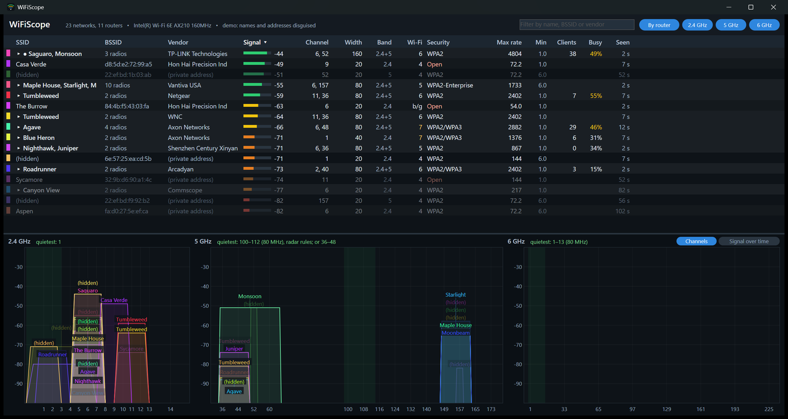

# WiFiScope

A free Wi-Fi scanner for Windows: every network your adapter hears, in a table
and on graphs of the 2.4, 5 and 6 GHz channels, so you can see which channels
are crowded and pick a better one for your router.

## What it shows

For each access point (each radio of each router):

- **Name, BSSID and Vendor**: the radio's MAC address and who made it (from the
  IEEE registry, built in). Your own network is marked with
  a dot. A ≡ after the BSSID marks a **Wi-Fi 7 multi-link** router.
  The vendor is whoever made the Wi-Fi hardware, which for many devices is a
  module maker (Foxconn / Hon Hai, Espressif, Realtek...) rather than the
  brand on the box. Made-up ("locally administered") addresses have no maker:
  WiFiScope shows them as a router's **extra network** (guest, IoT, mesh) when
  they match a router it hears, otherwise as a **private address**.
- **Signal** in dBm, with a bar: green above −60, yellow to −70, orange to −80,
  red below.
- **Channel, width and band**: the primary channel and the whole channel's width
  (20, 40, 80, 160, 80+80 or 320 MHz), read from the router's beacon.
- **Wi-Fi generation**: 4 (802.11n), 5 (ac), 6 (ax), 6E (ax on 6 GHz) or 7 (be).
- **Security**: Open, WEP, WPA, WPA2, WPA3, WPA2/WPA3, Enterprise, OWE.
- **Max rate**: the most the router could carry on its channel with its number
  of streams, and **Min**, its lowest basic rate.
- **Clients and Busy**: how many devices are connected and how much of the
  time the channel is busy, when the router reports them (many do).
- **Seen**: how long ago its last beacon was heard. Networks not heard for 30
  seconds fade, and go after two minutes.

The graphs draw each network across the channels it uses, as high as its
signal, the way inSSIDer does. Click a row to pick it out on the graphs.

## Using it

- Click a column heading to sort; click again to reverse.
- The **2.4 GHz / 5 GHz / 6 GHz** buttons show or hide a band; the box beside
  them filters by name or BSSID.
- Drag the line between the table and the graphs to resize them.
- Right-click for **Copy BSSID**, **Copy this row** or **Copy all rows**
  (tab-separated, for a spreadsheet), and **Scan now**.
- Keys: **↑ ↓** select, **Esc** clear the selection, **Page Up/Down** scroll,
  **F5** scan now.

It scans every five seconds; Windows decides when a scan actually happens, so
some networks update less often.

## What it needs

- Windows 10 or 11, 64-bit. Single exe, no installer, nothing to install.
- **Location access** must be on for desktop apps (Settings > Privacy &
  security > Location > "Let desktop apps access your location"). Windows
  treats Wi-Fi scanning as location information; without it the list stays
  nearly empty.
- **6 GHz networks** show only with a Wi-Fi 6E or Wi-Fi 7 adapter (Intel AX210,
  AX211, BE200 and the like). Wi-Fi 7 features (320 MHz, multi-link) are
  decoded from the beacons of any band your adapter hears.

## What it can't do

It shows Wi-Fi networks, not raw radio energy: interference from things that
aren't Wi-Fi (microwave ovens, baby monitors, some cameras' analog links)
needs dedicated spectrum-analyzer hardware.

## Updating the vendor list

Download the IEEE registry's ,  and
 from https://standards-oui.ieee.org/ and run

    python tools/make_oui.py oui.csv mam.csv oui36.csv

which rewrites .

## Building

Visual Studio 2019 or later with the C++ workload, and CMake:

    cmake -S . -B build -G "Visual Studio 16 2019" -A x64
    cmake --build build --config Release

`build/Release/decode_test.exe` checks the beacon decoder (exit code = failures).

## License

MIT - see [LICENSE](LICENSE).
