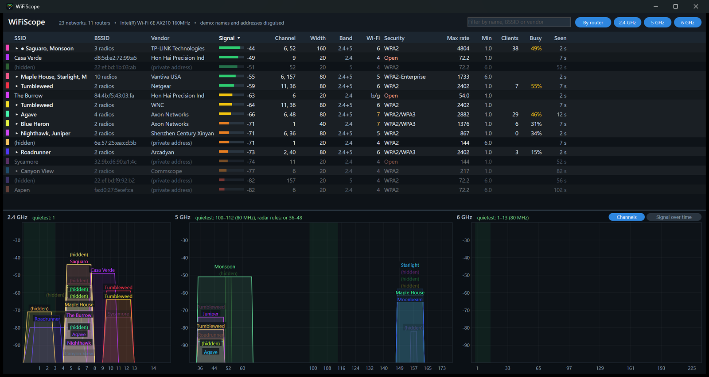
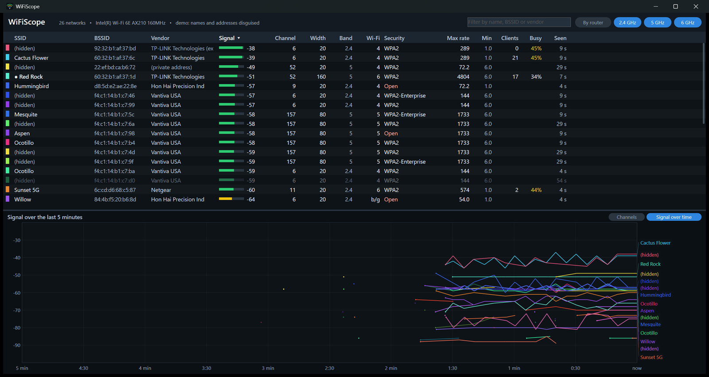
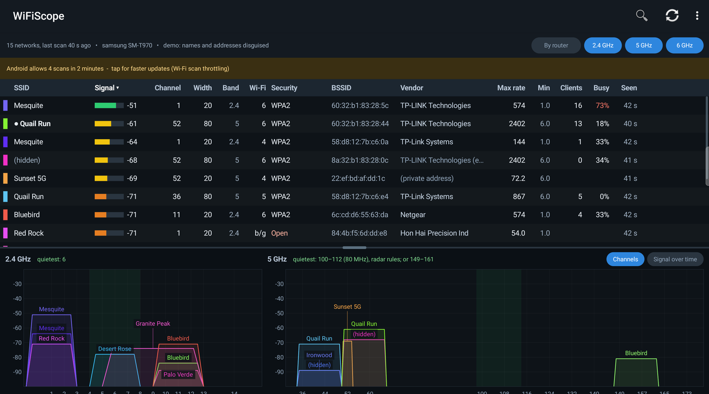

# WiFiScope

A free Wi-Fi scanner for Windows and Android: every network your adapter
hears, in a table and on graphs of the 2.4, 5 and 6 GHz channels or of their
signal over time, so you can see which channels are crowded and pick a better
one for your router - WiFiScope suggests the quietest.

(The [Android app](#android) is below.)

## What it shows

For each access point (each radio of each router):

- **Name, BSSID and Vendor**: the radio's MAC address and who made it (from the
  IEEE registry, built in). Your own network is marked with a dot. A ≡ after
  the BSSID marks a **Wi-Fi 7 multi-link** router.
  The vendor is whoever made the Wi-Fi hardware, which for many devices is a
  module maker (Foxconn / Hon Hai, Espressif, Realtek...) rather than the
  brand on the box. Made-up ("locally administered") addresses have no maker:
  WiFiScope shows them as a router's **extra network** (guest, IoT, mesh) when
  they match a router it hears, otherwise as a **private address**.
- **Signal** in dBm, with a bar: green above −60, yellow to −70, orange to −80,
  red below.
- **Channel, width and band**: the primary channel and the whole channel's width
  (20, 40, 80, 160, 80+80 or 320 MHz), read from the router's beacon.
- **Wi-Fi generation**: 4 (802.11n), 5 (ac), 6 (ax), 6E (ax on 6 GHz) or 7 (be).
- **Security**: Open, WEP, WPA, WPA2, WPA3, WPA2/WPA3, Enterprise, OWE.
- **Max rate**: the most the router could carry on its channel with its number
  of streams, and **Min**, its lowest basic rate.
- **Clients and Busy**: how many devices are connected and how much of the
  time the channel is busy, when the router reports them (many do).
- **Seen**: how long ago its last beacon was heard. Networks not heard for 30
  seconds fade, and go after two minutes.

Names starting with `DIRECT-` are **Wi-Fi Direct** networks that printers, TVs
and streaming boxes make for themselves (screen mirroring, remotes, printing
from phones). They use airtime on their channel like any other network.

**By router** groups each router's radios - its 2.4, 5 and 6 GHz networks, its
extra networks, the links of a Wi-Fi 7 multi-link device - under one row with
their total clients; click the row to open or close it.

## The graphs

- **Channels** draws each network across the channels it uses, as high as its
  signal, the way inSSIDer does. Above each band, **quietest** names the
  channel that would be least crowded for a router of yours (shaded green): it
  weighs every network heard - except your own router - by how loud it is, how
  much of the channel it covers and how busy it says it is. On 5 GHz it says
  when the quietest is a radar (DFS) channel, which routers must leave if
  radar is heard, and names the best ordinary one too. Some devices can't use
  every 5 GHz channel (149-165 especially), so check yours still connect after
  a change.
- **Signal over time** draws each network's signal over the last five minutes:
  handy for watching a camera or extender that keeps dropping out.

Click a row to pick it out on the graphs (a router's row picks out all its
radios).

## Using it

- Click a column heading to sort; click again to reverse.
- The **2.4 GHz / 5 GHz / 6 GHz** buttons show or hide a band; the box beside
  them filters by name, BSSID or vendor.
- Drag the line between the table and the graphs to resize them.
- Right-click for **Copy BSSID**, **Copy this row** or **Copy all rows**
  (tab-separated, for a spreadsheet), and **Scan now**.
- Keys: **↑ ↓** select, **→** / **Enter** open a router, **←** close it,
  **Esc** clear the selection, **Page Up/Down** scroll, **G** group by router,
  **T** signal over time / channels, **F5** scan now.
- **Sharing a screenshot?** Start it as `WiFiScope.exe --demo`: every network
  name is replaced by a made-up one and every address scrambled (a new random
  key each run), because BSSIDs can be looked up on Wi-Fi maps to find where
  they are - and the names are your neighbors'. The screenshots here were
  made that way.

It scans every five seconds; Windows decides when a scan actually happens, so
some networks update less often.

## Download

Get **WiFiScope-1.1.1-setup.exe** (installs for your user only, no admin rights
needed; adds a Start menu entry and an uninstaller) or just **WiFiScope.exe**
(run it from anywhere) from the [Releases](../../releases) page. Neither is
code-signed, so Windows SmartScreen may warn the first time: choose
**More info**, then **Run anyway**.

## What it needs

- Windows 10 or 11, 64-bit. One exe, no runtime or DLLs to install.
- **Location access** must be on for desktop apps (Settings > Privacy &
  security > Location > "Let desktop apps access your location"). Windows
  treats Wi-Fi scanning as location information; without it the list stays
  nearly empty.
- **6 GHz networks** show only with a Wi-Fi 6E or Wi-Fi 7 adapter (Intel AX210,
  AX211, BE200 and the like). Wi-Fi 7 features (320 MHz, multi-link) are
  decoded from the beacons of any band your adapter hears.

## Android

The same scanner for Android phones and tablets (Android 8 and later): the same
table, columns, channel graphs, quietest-channel advice, signal over time,
grouping by router and vendor list, decoded from the same beacon elements by
a port of the Windows decoder that is checked against it on real recorded
scans.

- **Install**: download **WiFiScope-1.2.apk** from the [Releases](../../releases)
  page on the phone or tablet and open it; Android asks once to allow installing
  apps from your browser or file manager.
- **Permissions**: Android shows apps the networks around only when they may use
  the device's **location** (Android 12 and earlier) or **nearby devices**
  (Android 13 and later); WiFiScope asks at the first start. Location (the
  quick-settings tile) must be on too. Nothing leaves the device.
- **How often it scans**: Android lets an app ask for only **4 scans in 2
  minutes**; between them WiFiScope shows what the system's own scans heard, and
  says how old the latest scan is. For a scan every 5 seconds, turn off
  **Wi-Fi scan throttling** in Settings > Developer options (tap the banner for
  how).
- **Touch**: tap a row to pick it out on the graphs; press and hold it for
  **Details** (streams, rates, country, multi-link address) and the copy
  commands; swipe the table sideways for more columns (the names stay put); tap
  a heading to sort; drag the bar under the table to resize it. On a phone the
  graphs show one band at a time - choose it with the buttons above the graph.
- **Sharing a screenshot?** Turn on **Demo mode** in the menu (made-up names,
  scrambled addresses, as `--demo` on Windows).
- Android 11 and later pass on each beacon's elements, so everything is
  decoded as on Windows. On Android 8-10 (or a device whose driver leaves them
  out), the width, security and generation come from Android's own summary and
  the rate, clients and busy columns stay empty.

The APK is signed but not from the Play Store, so Play Protect may ask whether
to install it; choose **Install anyway**.

## What it can't do

It shows Wi-Fi networks, not raw radio energy: interference from things that
aren't Wi-Fi (microwave ovens, baby monitors, some cameras' analog links)
needs dedicated spectrum-analyzer hardware.

## Updating the vendor list

Download the IEEE registry's `oui/oui.csv`, `oui28/mam.csv` and
`oui36/oui36.csv` from https://standards-oui.ieee.org/ and run

    python tools/make_oui.py oui.csv mam.csv oui36.csv

which rewrites `res/oui.txt`.

## Building

Visual Studio 2019 or later with the C++ workload, and CMake:

    cmake -S . -B build -G "Visual Studio 16 2019" -A x64
    cmake --build build --config Release

`build/Release/decode_test.exe` checks the beacon decoder and the channel
advice (exit code = failures).

The Android app (`android/`, Java, no libraries) builds with the Android SDK
(platform 36) and JDK 17 or later, e.g. Android Studio's:

    cd android
    gradlew assembleRelease testDebugUnitTest

The unit tests repeat `decode_test`'s checks on the Java decoder. To compare
the two decoders on real beacons, record a scan on Windows with
`build/Release/capture.exe android/captures/scan.txt` (the folder is ignored by
git - the file holds your neighbors' names and addresses) and run the tests
again: every network must decode the same on both. Pushed to the device as
`Android/data/com.ferrellsl.wifiscope/files/capture.txt`, the same scan can be
played back in the app (menu > Play back a recorded scan).

Release builds are signed with a key from `make-key.ps1`, kept outside the
repository (see `keystore.properties.example`).

## License

MIT - see [LICENSE](LICENSE).
